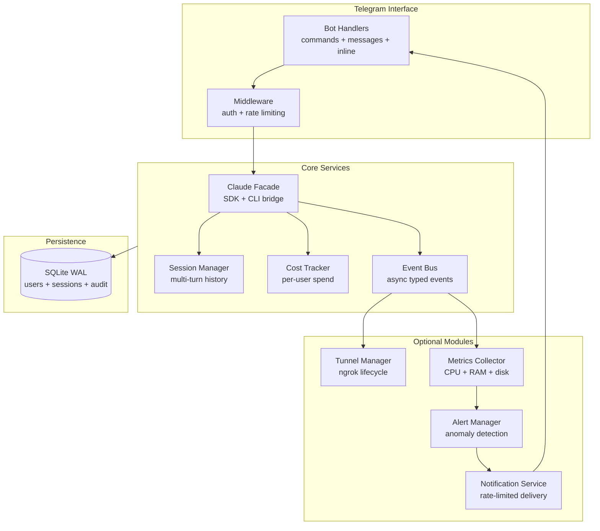

<div align="center">

# Claude Remote Bot

**Secure multi-user remote access to Claude Code through Telegram.**

[](https://github.com/sudohakan/Claude-Remote-Bot/actions/workflows/ci.yml)
[](https://github.com/sudohakan/Claude-Remote-Bot/releases)
[](LICENSE)
[](https://python.org)

</div>

## Features

Send a message from your phone, get Claude Code responses back. Manage SSH tunnels, monitor your system, upload files for analysis and export sessions, all from Telegram, with role-based access and cost controls built in.

- **Claude Agent SDK integration**: SDK-first with automatic CLI fallback. With `ANTHROPIC_API_KEY` set the bot uses the SDK directly, otherwise it shells out to the `claude` CLI. Multi-turn agentic mode is on by default with turn limits and timeouts.
- **Multi-user auth**: admin generates single-use invite tokens with `/invite`, users redeem them with `/start <token>`. Roles: `admin` (full control), `user` (chat, status, own sessions, uploads), `viewer` (read-only). Every command is audit-logged to SQLite.
- **Cost controls**: a per-request cap (`CLAUDE_MAX_COST_PER_REQUEST`) and a per-user daily cap. The daily cap is the user's own value set with `/limit`, else `CLAUDE_DEFAULT_USER_COST_LIMIT`, else `CLAUDE_MAX_COST_PER_USER`; a negative value means unlimited. Admins are exempt.
- **SSH tunnel management**: ngrok lifecycle with health polling, auto-restart, retry limits and admin alerts on up, down and retry-exhausted.
- **System monitoring**: CPU, RAM and disk via psutil, SSH session and failure counts, anomaly alerts with configurable thresholds, optional hourly reports (`/alerts on`).
- **File and image uploads**: send code, zip/tar archives and images to Claude with full context.
- **Session export**: chat history as Markdown, JSON or HTML.
- **Credential sanitizer**: Claude output is scrubbed for AWS keys, GitHub tokens, private key blocks and common secret patterns before delivery.
- **Anti-spam notifications**: state-change-only alerts, 5-minute dedup windows, one startup message total.
- **WSL watchdog**: a PowerShell watchdog restarts the bot if WSL or the process dies.
- The bot talks to its users in Turkish (replies, command help, prompts); code, comments and docs are English.

## Installation

1. Create a Telegram bot: message [@BotFather](https://t.me/BotFather), run `/newbot`, copy the token. Get your user ID from [@userinfobot](https://t.me/userinfobot).
2. Clone and configure:

```bash
git clone https://github.com/sudohakan/Claude-Remote-Bot.git
cd Claude-Remote-Bot
cp .env.example .env     # set TELEGRAM_BOT_TOKEN and ADMIN_TELEGRAM_ID
```

3. Install and start:

```bash
bash scripts/install.sh
```

The script installs dependencies, initializes SQLite, creates a systemd user service, and registers the Windows Task Scheduler watchdog.

Manual install:

```bash
pip install -e .
python3 -m src.main
```

### Configuration

All settings load from `.env` (copy `.env.example`). Required: `TELEGRAM_BOT_TOKEN` (from BotFather) and `ADMIN_TELEGRAM_ID`.

| Variable | Default | Description |
|---|:---:|---|
| `ANTHROPIC_API_KEY` | none | API key. Falls back to the `claude` CLI if unset |
| `CLAUDE_MODEL` | SDK default | Model override (any id the SDK accepts) |
| `CLAUDE_MAX_TURNS` | `10` | Max agentic turns per request |
| `CLAUDE_TIMEOUT_SECONDS` | `600` | Per-request timeout |
| `CLAUDE_MAX_COST_PER_REQUEST` | `1.0` | Per-request cost cap (USD) |
| `CLAUDE_MAX_COST_PER_USER` | `5.0` | Fallback daily cost cap per non-admin user (USD) |
| `CLAUDE_DEFAULT_USER_COST_LIMIT` | none | Default daily cap for users without their own; negative means unlimited |
| `CLAUDE_CLI_PATH` | `claude` on PATH | Path to the `claude` CLI |
| `SESSION_TIMEOUT_HOURS` | `24` | Idle time before a Claude session is dropped |
| `AGENTIC_MODE` | `true` | Multi-turn agentic execution |
| `RATE_LIMIT_CLAUDE_PER_MIN` | `20` | Claude requests per minute per user |
| `RATE_LIMIT_COMMANDS_PER_MIN` | `5` | Bot commands per minute per user |
| `RATE_LIMIT_INVITES_PER_HOUR` | `3` | Invite tokens per hour |
| `ENABLE_TUNNEL` | `false` | Enable the ngrok tunnel manager |
| `NGROK_AUTHTOKEN` | none | ngrok auth token |
| `SSH_PORT` | `22` | Local SSH port to expose |
| `TUNNEL_POLL_INTERVAL_SECONDS` | `30` | Tunnel health check interval |
| `TUNNEL_MAX_RETRIES` | `5` | Restart attempts before giving up |
| `ENABLE_MONITOR` | `true` | Enable the metrics collector |
| `MONITOR_COLLECT_INTERVAL_SECONDS` | `60` | Collection interval |
| `HOURLY_REPORT_ENABLED` | `false` | Scheduled hourly reports |
| `ALERT_CPU_PERCENT` | `90` | CPU alert threshold |
| `ALERT_RAM_PERCENT` | `85` | RAM alert threshold |
| `ALERT_DISK_PERCENT` | `90` | Disk alert threshold |
| `ALERT_SSH_FAILURES_PER_MIN` | `5` | Failed SSH logins per minute before an alert |
| `ENABLE_FILE_UPLOADS` | `true` | Allow file uploads to Claude |
| `ENABLE_GIT_INTEGRATION` | `true` | Read-only git commands |
| `ENABLE_API_SERVER` | `false` | Optional FastAPI HTTP server |
| `API_SERVER_PORT` | `8080` | Port for the FastAPI server |
| `ENABLE_VOICE_MESSAGES` | `false` | Voice message processing |
| `ENABLE_QUICK_ACTIONS` | `true` | Context-aware inline buttons |
| `DATABASE_URL` | `sqlite:///data/bot.db` | SQLite database |
| `LOG_LEVEL` | `INFO` | Log level |
| `DEBUG` | `false` | Debug mode |

## Usage

Service management:

```bash
systemctl --user status claude-remote-bot
systemctl --user restart claude-remote-bot
journalctl --user -u claude-remote-bot -f
```

### Commands for all users

| Command | Description |
|---|---|
| `/start [token]` | Start the bot or redeem an invite token |
| `/help` | Show available commands |
| `/ping` | Health check |
| `/new` | Start a new Claude session |
| `/status` | System status (CPU, RAM, disk) |
| `/ssh` | SSH tunnel info and connection details |
| `/history` | Recent command history |
| `/about` | Bot info and version |
| `/cwd` | Current working directory |
| `/remote` | Active remote-control sessions |

### Admin commands

| Command | Description |
|---|---|
| `/invite` | Generate a single-use invite token |
| `/users` | List all registered users |
| `/promote <user_id>` | Promote a user to admin |
| `/demote <user_id> [user\|viewer]` | Demote a user |
| `/revoke <token>` | Revoke an unused invite |
| `/limit [<user_id> <usd\|off\|reset>]` | List daily cost caps, or set one user's cap |
| `/stats` | 24-hour usage statistics |
| `/alerts [on\|off]` | Toggle hourly system reports |
| `/sessions` | List active Claude sessions |

### Optional integrations (owner only)

These commands call external tools from the owner's own setup. Each one works only when its target exists; point them elsewhere with the variables below.

| Command | Calls | Variable |
|---|---|---|
| `/auto <task>` | Autonomy queue CLI: adds a one-shot job; a second form shows a job's runs by id | `AUTONOMY_CLI` (default `~/.local/bin/auto`) |
| `/j <message>` | Relays a message to a leader agent session through its CLI | `JARVIS_CLI` (default `~/.local/bin/jarvis`) |
| `/ack` | Acknowledges that agent's escalation so it stops repeating | `JARVIS_CLI` |
| `/epic` | Runs a free-game claim script and sends a fresh link | `EPIC_CLAIM_SCRIPT`, `EPIC_CLAIM_PYTHON` |

Approve and Reject buttons under an agent's approval request call `JARVIS_CLI approve|reject <id>`.

### Security

- **Invite-token auth**: no token, no access. Single-use, admin-generated.
- **Role hierarchy**: admin > user > viewer, enforced in middleware.
- **Audit log**: every command and Claude interaction is logged to SQLite.
- **Rate limiting**: three independent sliding windows (Claude, commands, invites).
- **Path safety**: git integration is limited to an approved directory allowlist; no traversal, no symlink escapes.
- **Cost controls**: per-request and per-user daily caps, enforced mid-stream.

### Development

```bash
pip install -e ".[dev]"
pytest
```

Dev tools: pytest, black, isort, flake8, mypy. See [CONTRIBUTING.md](CONTRIBUTING.md) for full guidelines.

## Project structure

```
src/
  main.py             entry point
  bot/                handlers, middleware (auth, rate limiting), features, orchestrator, core
  claude/             SDK + CLI bridge, session management, cost tracking
  config/             Pydantic settings, feature flags
  events/             async typed event bus
  monitor/            psutil collector, reporter, anomaly alerts
  notifications/      rate-limited, dedup-aware delivery
  security/           invite auth, rate limiter, path validator, audit log
  storage/            SQLite (WAL mode) + repository pattern
  tunnel/             ngrok lifecycle manager + admin notifier
tests/                test suite
scripts/              install.sh, run-bot.sh, wsl-watchdog.ps1
pyproject.toml
```



Stack: Python 3.12+, python-telegram-bot 22, Claude Agent SDK, aiosqlite, Pydantic Settings, psutil, APScheduler, structlog, optional FastAPI + Uvicorn.

## License

MIT, see [LICENSE](LICENSE).
