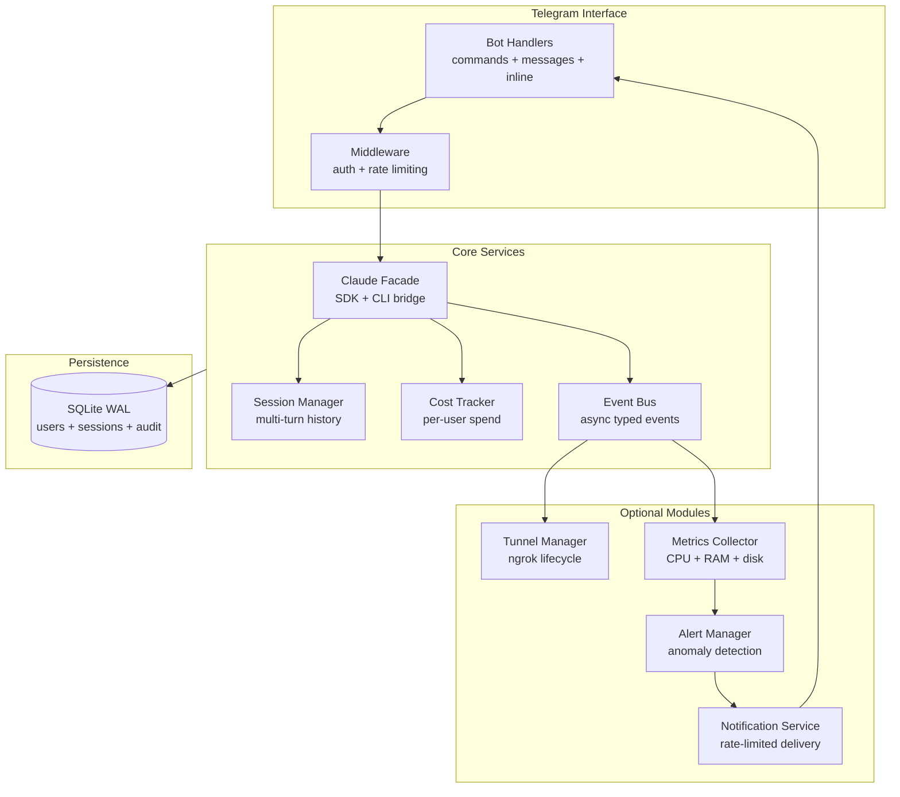

<div align="center">


# Claude Remote Bot

**Secure multi-user remote access to Claude Code via Telegram.**

SDK-first AI bridge · invite-token auth · SSH tunnel management · system monitoring · cost controls

[](https://github.com/sudohakan/Claude-Remote-Bot/releases)
[](https://python.org)
[](LICENSE)
[](https://github.com/sudohakan/Claude-Remote-Bot/actions)
[](https://github.com/sudohakan/Claude-Remote-Bot/stargazers)

[Quick Start](#install) · [Features](#features) · [Commands](#usage) · [Architecture](#architecture) · [Configuration](#configuration) · [Contributing](#development)

</div>

---

## What it does

> Send a message from your phone, get Claude Code responses back. Manage SSH tunnels, monitor your system, upload files for analysis, export sessions: all from Telegram, with role-based access and cost controls baked in.

| What you get | Details |
|:---|:---|
| **Claude Agent SDK integration** | SDK-first with automatic CLI fallback; multi-turn agentic mode with configurable turn limits |
| **Multi-user auth** | Invite-token system with admin / user / viewer roles and full audit log |
| **SSH tunnel management** | ngrok lifecycle with health polling, auto-restart, retry limits, and admin alerts |
| **System monitoring** | CPU, RAM, disk metrics via psutil; anomaly detection with configurable thresholds |
| **File and image uploads** | Send code, archives (zip/tar), and images directly to Claude for analysis |
| **Cost tracking** | Per-request cap plus a per-user daily cap, adjustable per user with `/limit` |
| **Session export** | Export chat history as Markdown, JSON, or HTML |
| **Credential sanitizer** | All Claude output is scrubbed for AWS keys, GitHub tokens, secrets before delivery |
| **Anti-spam notifications** | State-change-only alerts, dedup windows, optional hourly reports |
| **WSL watchdog** | PowerShell watchdog restarts the bot if WSL or the process dies |

---

## Install

**1. Create a Telegram bot**

Message [@BotFather](https://t.me/BotFather) on Telegram, run `/newbot`, copy the token.
Get your user ID from [@userinfobot](https://t.me/userinfobot).

**2. Clone and configure**

```bash
git clone https://github.com/sudohakan/Claude-Remote-Bot.git
cd claude-remote-bot
cp .env.example .env
# Set TELEGRAM_BOT_TOKEN and ADMIN_TELEGRAM_ID
```

**3. Install and start**

```bash
bash scripts/install.sh
```

The script installs dependencies, initializes SQLite, creates a systemd user service, and registers the Windows Task Scheduler watchdog.

<details>
<summary><strong>Manual install</strong></summary>

```bash
pip install -e .
python3 -m src.main
```

</details>

<details>
<summary><strong>Development install</strong></summary>

```bash
pip install -e ".[dev]"
pytest
```

Includes: pytest, black, isort, flake8, mypy.

</details>

<details>
<summary><strong>Service management</strong></summary>

```bash
systemctl --user status claude-remote-bot
systemctl --user restart claude-remote-bot
journalctl --user -u claude-remote-bot -f
```

</details>

---

## Features

### Claude Integration

SDK-first architecture with automatic CLI fallback. When `ANTHROPIC_API_KEY` is set, the bot uses the Claude Agent SDK directly. Otherwise, it shells out to the `claude` CLI. Multi-turn agentic mode is enabled by default with configurable turn limits and timeouts.

### Multi-User Authentication

Invite-token system: admin generates single-use tokens via `/invite`, users redeem with `/start <token>`. Three roles:

| Role | Access |
|:-----|:-------|
| `admin` | Full control: user management, broadcasts, tunnel ops, system stats |
| `user` | Chat with Claude, view status, manage own sessions, upload files |
| `viewer` | Read-only: status, history |

All commands are audit-logged to SQLite with timestamp, user ID, and action.

### Cost Controls

Two independent caps:
- **Per-request**: a request stops once it exceeds `CLAUDE_MAX_COST_PER_REQUEST`
- **Per-user daily**: a non-admin user is blocked for the rest of the day after spending their cap. The cap is the user's own value set with `/limit`, else `CLAUDE_DEFAULT_USER_COST_LIMIT`, else `CLAUDE_MAX_COST_PER_USER`; a negative value means unlimited. Admins are exempt.

### System Monitoring

psutil-based metrics collector with configurable thresholds:
- CPU, RAM, disk usage with anomaly alerts
- SSH session counting and failure rate tracking
- Optional hourly reports (default off, enable via `/alerts on`)
- State-change-only alerting: fires on transition, not while sustained

### SSH Tunnel Management

Full ngrok lifecycle: start, health polling, auto-restart on failure, configurable retry limits. Admin receives Telegram alerts on status transitions (up/down/retry-exhausted).

### File and Image Processing

Upload code files, zip/tar archives, and images directly in Telegram. The bot forwards them to Claude for analysis with full context.

### Notification Anti-Spam

Silent by default. State-change-only firing, 5-minute dedup windows, one startup message total (not one per module). Hourly reports are opt-in.

---

## Usage

### All Users

| Command | Description |
|:--------|:------------|
| `/start [token]` | Start the bot or redeem an invite token |
| `/help` | Show available commands |
| `/ping` | Health check |
| `/new` | Start a new Claude session |
| `/status` | System status (CPU, RAM, disk) |
| `/ssh` | SSH tunnel info and connection details |
| `/history` | Recent command history |
| `/about` | Bot info and version |
| `/cwd` | Current working directory |
| `/remote` | Active remote-control sessions |

### Admin Only

| Command | Description |
|:--------|:------------|
| `/invite` | Generate a single-use invite token |
| `/users` | List all registered users |
| `/promote <user_id>` | Promote a user to admin |
| `/demote <user_id> [user\|viewer]` | Demote a user |
| `/revoke <token>` | Revoke an unused invite |
| `/limit [<user_id> <usd\|off\|reset>]` | List daily cost caps, or set one user's cap |
| `/stats` | 24-hour usage statistics |
| `/alerts [on\|off]` | Toggle hourly system reports |
| `/sessions` | List active Claude sessions |

### Optional integrations (owner only)

These commands call external tools from the owner's own setup. Each one only works when its target exists; point them elsewhere with the variables below.

| Command | Calls | Variable |
|:--------|:------|:---------|
| `/auto <task>` | Autonomy queue CLI: adds a one-shot job, `/auto durum <id>` shows its runs | `AUTONOMY_CLI` (default `~/.local/bin/auto`) |
| `/j <message>` | Relays a message to a leader agent session through its CLI | `JARVIS_CLI` (default `~/.local/bin/jarvis`) |
| `/ack` | Acknowledges that agent's escalation so it stops repeating | `JARVIS_CLI` |
| `/epic` | Runs a free-game claim script and sends a fresh link | `EPIC_CLAIM_SCRIPT`, `EPIC_CLAIM_PYTHON` |

Approve / Reject buttons under an agent's approval request call `JARVIS_CLI approve|reject <id>`.

---

## Architecture

```
claude-remote-bot/
├── src/
│   ├── main.py                  # Entry point
│   ├── bot/
│   │   ├── handlers/            # Command, message, callback handlers
│   │   ├── middleware/           # Auth and rate limiting middleware
│   │   ├── features/            # File, image, voice, git, session export, quick actions
│   │   ├── orchestrator.py      # Service wiring
│   │   └── core.py              # Bot lifecycle
│   ├── claude/                  # SDK + CLI bridge, session management, cost tracking
│   ├── config/                  # Pydantic settings, feature flags
│   ├── events/                  # Async typed event bus
│   ├── monitor/                 # psutil collector, reporter, anomaly alerts
│   ├── notifications/           # Rate-limited, dedup-aware delivery
│   ├── security/                # Invite auth, rate limiter, path validator, audit log
│   ├── storage/                 # SQLite (WAL mode) + repository pattern
│   └── tunnel/                  # ngrok lifecycle manager + admin notifier
├── tests/                       # test suite
├── scripts/
│   ├── install.sh               # Automated setup
│   ├── run-bot.sh               # Run script
│   └── wsl-watchdog.ps1         # Windows Task Scheduler watchdog
└── pyproject.toml
```



---

## Configuration

All settings loaded from `.env`. Copy `.env.example` to get started.

### Required

| Variable | Description |
|:---------|:------------|
| `TELEGRAM_BOT_TOKEN` | Bot token from [@BotFather](https://t.me/BotFather) |
| `ADMIN_TELEGRAM_ID` | Your Telegram user ID |

### Claude / Anthropic

| Variable | Default | Description |
|:---------|:-------:|:------------|
| `ANTHROPIC_API_KEY` | -- | API key. Falls back to `claude` CLI if unset |
| `CLAUDE_MODEL` | SDK default | Model override (any model id the SDK accepts, e.g. a `sonnet` alias) |
| `CLAUDE_MAX_TURNS` | `10` | Max agentic turns per request |
| `CLAUDE_TIMEOUT_SECONDS` | `600` | Per-request timeout |
| `CLAUDE_MAX_COST_PER_USER` | `5.0` | Fallback daily cost cap per non-admin user (USD) |
| `CLAUDE_DEFAULT_USER_COST_LIMIT` | -- | Default daily cap for users without their own; negative = unlimited |
| `CLAUDE_CLI_PATH` | `claude` on PATH | Path to the `claude` CLI |
| `SESSION_TIMEOUT_HOURS` | `24` | Idle time before a Claude session is dropped |
| `CLAUDE_MAX_COST_PER_REQUEST` | `1.0` | Per-request cost cap (USD) |
| `AGENTIC_MODE` | `true` | Multi-turn agentic execution |

### Rate Limiting

| Variable | Default | Description |
|:---------|:-------:|:------------|
| `RATE_LIMIT_CLAUDE_PER_MIN` | `20` | Claude requests per minute per user |
| `RATE_LIMIT_COMMANDS_PER_MIN` | `5` | Bot commands per minute per user |
| `RATE_LIMIT_INVITES_PER_HOUR` | `3` | Invite tokens per hour |

### SSH Tunnel (ngrok)

| Variable | Default | Description |
|:---------|:-------:|:------------|
| `ENABLE_TUNNEL` | `false` | Enable ngrok tunnel manager |
| `NGROK_AUTHTOKEN` | -- | ngrok auth token |
| `SSH_PORT` | `22` | Local SSH port to expose |
| `TUNNEL_POLL_INTERVAL_SECONDS` | `30` | Health check interval |
| `TUNNEL_MAX_RETRIES` | `5` | Restart attempts before giving up |

### System Monitor

| Variable | Default | Description |
|:---------|:-------:|:------------|
| `ENABLE_MONITOR` | `true` | Enable metrics collector |
| `MONITOR_COLLECT_INTERVAL_SECONDS` | `60` | Collection interval |
| `HOURLY_REPORT_ENABLED` | `false` | Scheduled hourly reports |
| `ALERT_CPU_PERCENT` | `90` | CPU alert threshold |
| `ALERT_RAM_PERCENT` | `85` | RAM alert threshold |
| `ALERT_DISK_PERCENT` | `90` | Disk alert threshold |
| `ALERT_SSH_FAILURES_PER_MIN` | `5` | Failed SSH logins per minute before an alert |

### Feature Flags

| Variable | Default | Description |
|:---------|:-------:|:------------|
| `ENABLE_FILE_UPLOADS` | `true` | Allow file uploads to Claude |
| `ENABLE_GIT_INTEGRATION` | `true` | Read-only git commands |
| `ENABLE_API_SERVER` | `false` | FastAPI HTTP server |
| `ENABLE_VOICE_MESSAGES` | `false` | Voice message processing |
| `ENABLE_QUICK_ACTIONS` | `true` | Context-aware inline buttons |

### Storage and logging

| Variable | Default | Description |
|:---------|:-------:|:------------|
| `DATABASE_URL` | `sqlite:///data/bot.db` | SQLite database |
| `API_SERVER_PORT` | `8080` | Port for the optional FastAPI server |
| `LOG_LEVEL` | `INFO` | Log level |
| `DEBUG` | `false` | Debug mode |

---

## Security

- **Invite-token auth**: no token, no access. Single-use, admin-generated.
- **Role hierarchy**: admin > user > viewer. Enforced at middleware level.
- **Audit log**: every command and Claude interaction logged to SQLite.
- **Rate limiting**: three independent sliding windows (Claude, commands, invites).
- **Path safety**: git integration restricted to approved directory allowlist. No traversal, no symlink escapes.
- **Credential sanitizer**: Claude output scrubbed for AWS keys, GitHub tokens, private key blocks, common secret patterns.
- **Cost controls**: per-request and per-user monthly caps, enforced mid-stream.

---

## Tech Stack

| Component | Technology |
|:----------|:-----------|
| Runtime | Python 3.12+ |
| Telegram | python-telegram-bot 22 (async, rate-limiter extras) |
| AI | Claude Agent SDK + Anthropic API |
| Database | SQLite (WAL mode) via aiosqlite |
| Settings | Pydantic Settings + python-dotenv |
| Monitoring | psutil |
| HTTP server | FastAPI + Uvicorn (optional) |
| Scheduling | APScheduler |
| Logging | structlog |

---

## Development

See [CONTRIBUTING.md](CONTRIBUTING.md) for full guidelines.

```bash
git clone https://github.com/sudohakan/Claude-Remote-Bot.git
cd claude-remote-bot
pip install -e ".[dev]"
pytest
```

---

## License

[MIT](LICENSE) — Copyright 2026 Hakan Topcu

<div align="center">

Built with Python  ·  Powered by [Claude Agent SDK](https://github.com/anthropics/claude-code)  ·  Delivered via [Telegram](https://telegram.org)

</div>
